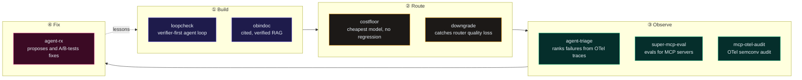

<p align="center">
  
</p>

<p align="center">
  <a href="https://thebharath.co"></a>
  <a href="https://linkedin.com/in/thebharathkumar"></a>
  <a href="mailto:bharath.kr702@gmail.com"></a>
  <a href="https://medium.com/@thebharathkumar"></a>
  <a href="https://twitter.com/passdweed"></a>
  <a href="https://open.spotify.com/show/4PDEqJu1u06pqcvBFF4BRA"></a>
  <a href="https://pypi.org/project/agent-triage/"></a>
</p>

<h3 align="center">Agents fail quietly. I build the tooling that makes them fail loudly.</h3>

<br/>

## ✅ The receipts

<p align="center">
  
</p>

Every number on this page traces to a production system, a public repo, or a published paper. Where a result is weak, the repo says so.

## 🏗️ In production

**Multi-agent student platform** · Graduate Assistant, Pace University

LangGraph + Claude on Amazon Bedrock. Answers student questions and guides course selection, grounded in each student's own transcripts and university documents, with every student scoped to their own records.

| 10K+ | 99.5% | 12 | 0.92 | 200+ | 4 |
|:---:|:---:|:---:|:---:|:---:|:---:|
| daily users | uptime | zero-regression releases | MRR@5 over 50K+ docs | eval tests per release | silent regressions caught before users |

## 🧭 The reliability stack

Most of what I open-source answers one question: **how do you know an LLM system still works after you change it?** Each tool covers a different stage.



Try one in a few seconds:

```bash
pip install agent-triage
```

## 🚀 Featured work

| Project | What it does | Proof |
|---|---|---|
| [**ForgeSync**](https://github.com/thebharathkumar/ForgeSync) | Financial integration and reconciliation infra. Normalizes invoices across wire formats into one model, scores matches with explainable signals, gates every write-back behind human approval, keeps an immutable audit trail. | TypeScript · 125 unit + 75 integration tests on real Postgres and Redis · scoring runs ~25x faster than ingestion, so the bottleneck is I/O, not the engine |
| [**loopcheck**](https://github.com/thebharathkumar/loopcheck) | Verifier-first agent loop with an HMAC-chained audit log. `loopcheck demo` runs offline in under 2 seconds. | 86 tests · precision 1.00 / recall 0.33 on a 15-file seed set, published with its limitations |
| [**downgrade**](https://github.com/thebharathkumar/downgrade) | Measures silent quality loss when a model router downgrades requests. Six-type regression classifier across Fireworks, OpenRouter, and LiteLLM routing. | OTel GenAI semconv · in active development |
| [**costfloor**](https://github.com/thebharathkumar/costfloor) | Finds the cheapest model per task family with no silent regression against the expensive baseline. Refuses to claim a dollar saving without a real rate card. | 47 tests · CI on Python 3.11 and 3.12 · offline demo in ~0.3s |
| [**agent-triage**](https://github.com/thebharathkumar/agent-triage) | Ranks multi-agent failures by severity, frequency, and recovery from OpenTelemetry or NDJSON traces. CLI, FastAPI dashboard, OTLP receiver. | On PyPI · 220+ tests · 93%+ coverage |
| [**agent-rx**](https://github.com/thebharathkumar/agent-rx) | Closes the loop on agent-triage: diagnoses failures, proposes fixes, A/B-tests them, and learns which fixes are worth making. | Python |
| [**super-mcp-eval**](https://github.com/thebharathkumar/super-mcp-eval) | Eval harness for MCP servers and the agents that use them: schema compliance and tool-selection accuracy. | Wilson 95% CIs · DuckDB · Streamlit |
| [**mcp-otel-audit**](https://github.com/thebharathkumar/mcp-otel-audit) | Public audit of 4 MCP OpenTelemetry instrumentations against OTel semantic conventions v1.40.0. | Fully reproducible · engaged Logfire and MCP Python maintainers |
| [**obindoc**](https://github.com/thebharathkumar/obindoc) | Grounded RAG over a PDF with span-level citations, a verifier loop, and a tamper-evident audit log. | Under 900 lines · 29 tests |

<details>
<summary><b>Applied ML</b></summary>
<br/>

| Project | What it does | Proof |
|---|---|---|
| [**vehicle-damage-detection**](https://github.com/thebharathkumar/vehicle-damage-detection) | YOLO11s-seg fine-tuned on CarDD with imbalance ablation, error analysis, and a robustness suite. Served via FastAPI and Docker. | 0.753 mask mAP50 on held-out data |
| [**streamsense**](https://github.com/thebharathkumar/streamsense) | Multimodal activity recognition on PAMAP2 wearable IMU data with a late-fusion CNN + transformer. | ONNX export · int8 quantization · FastAPI inference |

</details>

## 🔁 Upstream

- [**artie-labs/transfer**](https://github.com/artie-labs/transfer) (Go): 3 PRs covering an Elasticsearch destination, a Kinesis source consumer, and CONTRIBUTING docs
- **faramesh-core**: 9 PRs, including merged #33 (delegation token policy)
- [**Meshery**](https://github.com/meshery/meshery) (Layer5, CNCF): contributions

## 📚 Research

- **A Deep CNN Approach for Identifying Medicinal and Edible Plants in the Western Ghats.** [ICACECS 2023, Atlantis Press (Springer Nature)](https://www.atlantis-press.com/proceedings/icacecs-23/125995742). 89% accuracy. *Corresponding author.*
- **Driver Drowsiness Detection using AI.** [IJARESM, Vol. 11, Nov 2023](https://www.ijaresm.com/sahasransu-mohanty). Dlib eye-aspect-ratio with a Keras CNN, shipped as an Android app.

## 🛠️ Toolbox

<p align="center">
  
</p>

**AI / LLM:** Claude, Amazon Bedrock, LangGraph, LangChain, MCP, OpenTelemetry, RAG, LLM evals<br/>
**Backend / Infra:** FastAPI, Fastify, Prisma, Zod, BullMQ, AWS CDK, Terraform, Docker Compose<br/>
**Testing / Data:** pytest, Vitest, Playwright, DuckDB, Streamlit, ONNX

<p align="center">
  
  
  
</p>

## 🐍 Shipping log

<p align="center">
  <picture>
    <source media="(prefers-color-scheme: dark)" srcset="https://raw.githubusercontent.com/thebharathkumar/thebharathkumar/output/github-snake-dark.svg" />
    
  </picture>
</p>

---

<p align="center"><sub>Open to AI Engineer, Applied AI Engineer, and Forward Deployed Engineer roles · NYC, open to relocation · Currently work-authorized on F-1 OPT</sub></p>
