  

  
  
  
  
  
  
  

  An agent states a number with full confidence. Nobody can say where it came from, 
  whether the sources agree, or whether the log was edited afterwards. 
  <b>Most of what I build exists to answer those three questions.</b>

 

## ✅ The receipts

  

## 🧪 House rules

Every repo below follows the same five rules. Each one links to a place you can check it.

| Rule | Where you can see it |
|---|---|
| **Every number comes from a file the code wrote.** No result is typed by hand. | [ForgeSync](https://github.com/thebharathkumar/ForgeSync) commits a timestamped JSON report for every benchmark run · [gcf-virome](https://github.com/thebharathkumar/gcf-virome) cites the output file behind each figure |
| **Thresholds are fixed before the results, never tuned after.** | [gcf-virome](https://github.com/thebharathkumar/gcf-virome) pre-registers its presence filter · [downgrade](https://github.com/thebharathkumar/downgrade) refuses to load runs whose FDR level was edited after the fact |
| **A weak result is reported as weak.** | [loopcheck](https://github.com/thebharathkumar/loopcheck) publishes recall 0.33 · [gcf-virome](https://github.com/thebharathkumar/gcf-virome) reports a null PERMANOVA (p = 0.98) as null · [estimate-check](https://github.com/thebharathkumar/estimate-check) says its own metrics do not support an accuracy claim |
| **The demo runs offline, with no API key, in seconds.** | `loopcheck demo` · `claimtrace demo` · `costfloor` · `python3 -m estimate_check demo` |
| **Say what I don't know.** | [estimate-check](https://github.com/thebharathkumar/estimate-check) opens its limits section with "I have never worked in restoration" |

## 🏗️ In production

**Multi-agent student platform** · Graduate Assistant, Pace University

LangGraph + Claude on Amazon Bedrock. It answers student questions and guides course selection, grounded in each student's own transcripts and university documents, with every student scoped to their own records.

| 10K+ | 99.5% | 12 | 0.92 | 200+ | 4 |
|:---:|:---:|:---:|:---:|:---:|:---:|
| daily users | uptime | zero-regression releases | MRR@5 over 50K+ docs | eval tests per release | silent regressions caught before users |

## 🔦 Flagships

<table>
<tr>
<td width="33%" valign="top">

### [agent-triage](https://github.com/thebharathkumar/agent-triage)
Ranks multi-agent failures by severity, frequency, and recovery from OpenTelemetry or NDJSON traces. Ships a CLI, a FastAPI dashboard, and an OTLP receiver.

`pip install agent-triage`

**220+ tests · 93%+ coverage · on PyPI**

</td>
<td width="33%" valign="top">

### [mcp-otel-audit](https://github.com/thebharathkumar/mcp-otel-audit)
A reproducible audit of 4 MCP OpenTelemetry libraries against semconv v1.40.0. **None of the 4 ship the spec's MCP histograms.** 2 of 4 emit no MCP semconv attributes at all.

**A maintainer of Logfire and the MCP Python SDK responded to it in the OTel community.**

</td>
<td width="33%" valign="top">

### [ForgeSync](https://github.com/thebharathkumar/ForgeSync)
Financial reconciliation infra. Normalizes invoices across wire formats, scores matches with explainable signals, and gates every write-back behind human approval.

**125 unit + 75 integration tests on real Postgres and Redis · scoring runs ~25x ingestion, so the bottleneck is I/O, not the engine**

</td>
</tr>
</table>

## 🧭 The reliability stack

Each tool covers one stage of keeping an LLM system honest after you change it.

```mermaid
flowchart LR
    subgraph B["① Build"]
        LC["loopcheck<br/>verifier-first agent loop"]
        CT["claimtrace<br/>every claim traced to a char span"]
        OD["obindoc<br/>cited, verified RAG"]
    end
    subgraph R["② Route"]
        CF["costfloor<br/>cheapest model, no regression"]
        DG["downgrade<br/>catches router quality loss"]
    end
    subgraph O["③ Observe"]
        AT["agent-triage<br/>ranks failures from traces"]
        FR["agent-flight-recorder<br/>audit + tracing skills"]
        SM["super-mcp-eval<br/>evals for MCP servers"]
        MO["mcp-otel-audit<br/>OTel semconv audit"]
    end
    subgraph F["④ Fix"]
        RX["agent-rx<br/>proposes and A/B-tests fixes"]
    end
    B --> R --> O --> F
    F -. lessons .-> B

    classDef build fill:#1e1b4b,stroke:#7C6CF2,color:#e6edf3
    classDef route fill:#1c1917,stroke:#F59E0B,color:#e6edf3
    classDef observe fill:#052e2b,stroke:#10B981,color:#e6edf3
    classDef fix fill:#3b0a24,stroke:#EC4899,color:#e6edf3
    class LC,CT,OD build
    class CF,DG route
    class AT,FR,SM,MO observe
    class RX fix
```

| Project | What it does | Proof |
|---|---|---|
| [**loopcheck**](https://github.com/thebharathkumar/loopcheck) | Verifier-first agent loop: should you trust that the agent actually finished? Mutation-tested verification, calibrated confidence, HMAC-chained audit log. | 86 tests · precision 1.00 / recall 0.33 on a 15-file seed set, published with its limits |
| [**claimtrace**](https://github.com/thebharathkumar/Claimtrace) | Five-node LangGraph pipeline where every claim points to an exact source chunk and character span. Claims with no source are dropped. Sources that contradict each other get flagged. | Byte-flip tamper test on the audit chain · spans exported to agent-triage over OTLP |
| [**downgrade**](https://github.com/thebharathkumar/downgrade) | Measures silent quality loss when a model router downgrades a request: a dropped tool call, a lost constraint, a number from nowhere. | Anytime-valid sequential tests, Wald SPRT, Benjamini-Hochberg, Kupiec and Christoffersen backtests |
| [**costfloor**](https://github.com/thebharathkumar/costfloor) | Finds the cheapest model that does not silently break your agent. Refuses to claim a dollar saving without a real rate card. | 47 tests · CI on Python 3.11 and 3.12 |
| [**agent-flight-recorder**](https://github.com/thebharathkumar/agent-flight-recorder) | Claude Code plugin: hash-chained audit logs, OTel tracing for LangGraph and MCP, deterministic eval scaffolds, trace triage. | 90% coverage gate in CI · plugin validated with `--strict` |
| [**agent-rx**](https://github.com/thebharathkumar/agent-rx) | Closes the loop on agent-triage: diagnoses failures, proposes fixes, A/B-tests them, and learns which fixes are worth making. | Python · MIT |
| [**super-mcp-eval**](https://github.com/thebharathkumar/super-mcp-eval) | Eval harness for MCP servers and the agents that use them: schema compliance and tool-selection accuracy. | Wilson 95% CIs · DuckDB · Streamlit |
| [**obindoc**](https://github.com/thebharathkumar/obindoc) | Grounded RAG over a PDF with span-level citations, a verifier loop, and a tamper-evident audit log. | Under 900 lines · 29 tests |

## 🔬 Same rigor, other domains

| Project | Domain | What makes it worth a look |
|---|---|---|
| [**gcf-virome**](https://github.com/thebharathkumar/gcf-virome) | Bioinformatics | One-command Snakemake pipeline from SRA download to PERMANOVA on public periodontal metagenomes. It reports a null result as null. It ran its own follow-up: host depletion removed 88.9% of reads, and the baseline rerun reproduced the original count table exactly. 40 tests on a REDCap / NCBI metadata validator. |
| [**estimate-check**](https://github.com/thebharathkumar/estimate-check) | Insurance restoration | Deterministic verifier for estimate line items, with six detectors, every verdict tied to the rule and evidence behind it, and zero runtime dependencies. Its optional LLM judge can annotate findings but never change them. |
| [**vehicle-damage-detection**](https://github.com/thebharathkumar/vehicle-damage-detection) | Computer vision | YOLO11s-seg fine-tuned on CarDD: **0.753 mask mAP50** on held-out data, plus an imbalance ablation, error analysis, and a robustness suite. Served via FastAPI and Docker. |
| [**streamsense**](https://github.com/thebharathkumar/streamsense) | Wearables | Late-fusion CNN + transformer for activity recognition on PAMAP2, with ONNX export, int8 quantization, and FastAPI inference. |

## 🔁 Upstream

- [**faramesh/faramesh-core**](https://github.com/faramesh/faramesh-core) (Go, AI agent governance): authored 9 PRs. Merged [#33](https://github.com/faramesh/faramesh-core/pull/33), which wires delegation tokens into runtime policy evaluation.

## 📚 Research & writing

- **A Deep CNN Approach for Identifying Medicinal and Edible Plants in the Western Ghats.** [ICACECS 2023, Atlantis Press (Springer Nature)](https://www.atlantis-press.com/proceedings/icacecs-23/125995742). 89% accuracy. *Corresponding author.*
- **Driver Drowsiness Detection using AI.** [IJARESM, Vol. 11, Nov 2023](https://www.ijaresm.com/sahasransu-mohanty). Dlib eye-aspect-ratio with a Keras CNN, shipped as an Android app.
- **Auditing MCP OpenTelemetry instrumentations:** [the writeup](https://github.com/thebharathkumar/mcp-otel-audit/blob/main/docs/blog/auditing-mcp-otel.md) behind mcp-otel-audit. More on [Medium](https://medium.com/@thebharathkumar).

## 🛠️ Toolbox

  

**AI / LLM:** Claude, Amazon Bedrock, LangGraph, MCP, OpenTelemetry (GenAI semconv), RAG, LLM evals 
**Backend / Infra:** FastAPI, Fastify, Prisma, Zod, BullMQ, AWS CDK, Terraform, Docker Compose 
**Testing / Data / Science:** pytest, Vitest, Playwright, DuckDB, Streamlit, ONNX, Snakemake, R (vegan)

  
  
  

## 🐍 Shipping log

  <picture>
    <source media="(prefers-color-scheme: dark)" srcset="https://raw.githubusercontent.com/thebharathkumar/thebharathkumar/output/github-snake-dark.svg" />
    
  </picture>

---

Open to AI Engineer, Applied AI Engineer, and Forward Deployed Engineer roles · NYC, open to relocation · Currently work-authorized on F-1 OPT Off the clock: Rubik's cube in under 2 minutes, and a podcast.

